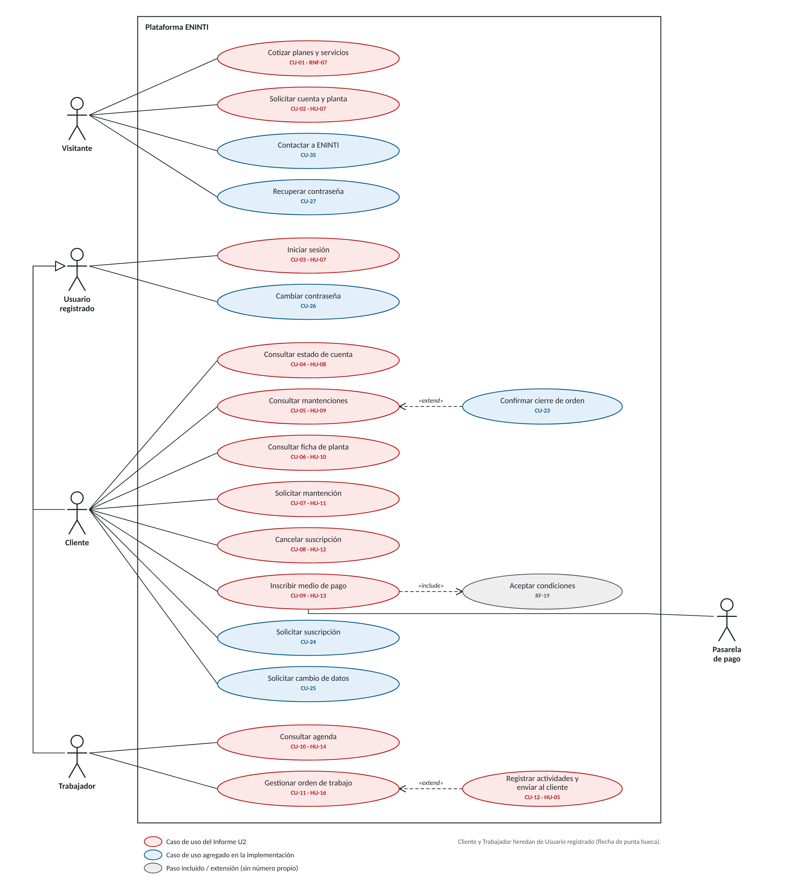
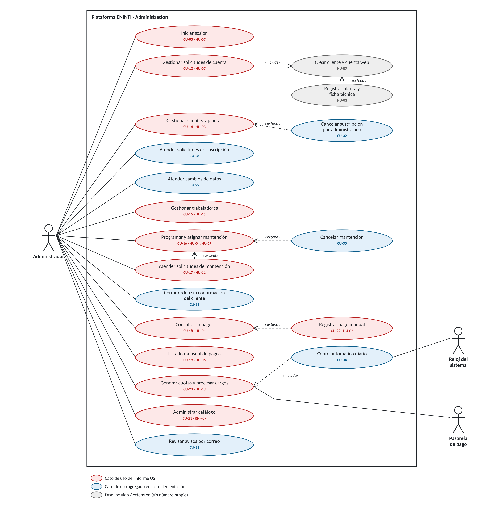

# Casos de uso actualizados · ENINTI

Este documento pone al día el **Informe U2** (Ilustraciones 3 y 4 y Tabla 6, págs. 12-15)
con lo que hace el prototipo en `main`. Tiene tres partes:

1. [Correcciones a los casos de uso existentes](#1-correcciones-a-los-casos-de-uso-existentes) (incluye CU-09 y CU-12).
2. [Casos de uso nuevos](#2-casos-de-uso-nuevos-cu-23-a-cu-35) que el prototipo ya implementa y faltan en los diagramas (CU-23 a CU-35).
3. [Diagramas en PlantUML](#3-diagramas-en-plantuml) listos para regenerar las imágenes.

**Imágenes listas para la presentación:** `docs/diagramas/casos_de_uso_1_visitante_cliente_trabajador.png` y `docs/diagramas/casos_de_uso_2_administrador.png` (también en SVG). Se generan con `python3 docs/diagramas/generar_casos_de_uso.py docs/diagramas`.





Para encontrar el código de cualquier caso de uso, busca su número en todo el
proyecto (VS Code: `Ctrl+Shift+F` → `CU-09`). Cada función lleva su etiqueta.

---

## 1. Correcciones a los casos de uso existentes

Solo se listan las filas de la Tabla 6 que cambian. Las demás (CU-01 a CU-07,
CU-10, CU-13 a CU-17, CU-19 a CU-21) coinciden con el prototipo.

| Caso de uso | Qué decía el informe | Cómo queda (texto para reemplazar) |
|---|---|---|
| **CU-09 Inscribir medio de pago** + «include» Aceptar condiciones (HU-13 / RF-09, RF-19) | Precondición: "aceptación de condiciones registrada (include)". En el prototipo el botón enviaba la aceptación sin mostrar las condiciones. | **Precondiciones:** suscripción vigente; el cliente lee las condiciones del servicio (versión vigente) y marca la casilla «He leído y acepto»; sin la casilla el botón «Aceptar y continuar» está deshabilitado y la API responde 400. **Postcondiciones:** queda registrada la aceptación con fecha, versión e IP (`aceptacion_condiciones`); medio de pago activo guardado solo como token y últimos 4 dígitos; el anterior queda inactivo. *(Corregido: `frontend/src/modules/cliente/components/AceptarCondiciones.jsx`.)* |
| **CU-11 Gestionar orden de trabajo** (HU-16 / RF-24, RF-25) | Estados pendiente → en curso → finalizada. | **Precondiciones:** la orden está asignada al trabajador y está `pendiente` o `en_curso`. **Postcondiciones:** transición válida registrada en el historial (quién, cuándo, de qué estado a cuál); un salto inválido responde 409. Estados: `pendiente → en_curso → por_confirmar → finalizada`; `pendiente/en_curso → cancelada`; `por_confirmar → en_curso` si el cliente reclama. |
| **CU-12 Registrar actividades y finalizar** «extend» de CU-11 (HU-05 / RF-07) | **Postcondición:** "Orden finalizada con fecha de ejecución y actividades; visible para cliente y administrador." | **Nombre sugerido:** *Registrar actividades y enviar al cliente*. **Precondiciones:** orden `en_curso`; actividades ingresadas y entre 1 y 4 fotos del trabajo (máx. 3 MB c/u). **Postcondiciones:** la orden queda **`por_confirmar`** con fecha de ejecución, actividades, observaciones y fotos; el historial registra el cambio. La orden recién queda **`finalizada`** cuando el cliente confirma (CU-23) o el administrador la cierra (CU-31). |
| **CU-08 Cancelar suscripción** (HU-12 / RF-16) | "Suscripción cancelada con fecha; no se generan nuevas cuotas." | Se agrega: queda registrado el **motivo** (`cliente`); se anulan las cuotas aún no vencidas y se cancelan las mantenciones **preventivas** pendientes de esa planta. La deuda vencida se mantiene por cobrar. Para volver a tener plan, el cliente usa CU-24. |
| **CU-18 Consultar impagos** (HU-01 / RF-01) | "Listado de morosos…" | El estado de la suscripción con deuda se llama **`con_deuda`** (no `morosa`). Regla: cuota vencida → `con_deuda` (sigue activa); deuda más antigua > 1 mes → `cancelada` por `morosidad`. El listado incluye la deuda de suscripciones canceladas por morosidad. |
| **CU-20 Generar cuotas y procesar cargos** (HU-13) | Lo ejecuta el administrador. | Se agrega: también lo ejecuta **automáticamente una vez al día** (CU-34). Cada intento queda en `intento_cargo`; un rechazo no cambia la cuota. |
| **CU-22 Registrar pago manual** «extend» de CU-18 (HU-02 / RF-05) | — | Se agrega: el monto debe ser el **total** de la cuota (no hay abonos); una transferencia exige el N° de operación. |
| **CU-14 Gestionar clientes y plantas** (HU-03 / RF-02) | — | Se agrega «extend» **Gestionar suscripción de la planta**: crear, cambiar cuota o día de cobro (1 a 28) y **cancelar por administración** (motivo `administrador`). Cambiar el dueño de una planta se rechaza si tiene suscripción vigente, cuotas impagas o visitas abiertas. |

**Nota sobre el modelo de datos:** el informe dice "catorce entidades". Hoy son 21
tablas; se agregaron `solicitud_suscripcion`, `solicitud_cambio_datos`,
`mantencion_foto`, `aviso_correo`, `recuperacion_contrasena`, `intento_cargo` y
`ejecucion_tarea` (migraciones `004` a `008`).

---

## 2. Casos de uso nuevos (CU-23 a CU-35)

| Caso de uso | Actor | Precondiciones | Postcondiciones | Código |
|---|---|---|---|---|
| **CU-23 Confirmar cierre de orden** | Cliente | La orden de una planta propia está `por_confirmar`. Si el problema no se resolvió, el comentario es obligatorio. | Problema resuelto → orden `finalizada` y la solicitud de origen `cerrada`. No resuelto → vuelve a `en_curso` con el comentario del cliente. Queda en el historial. | `cliente.service.js · confirmarOrden` · `MantencionesClientePage.jsx` |
| **CU-24 Solicitar suscripción** | Cliente | La planta es propia y no tiene suscripción vigente; no hay otra solicitud pendiente para ella. | Solicitud `pendiente` visible para el administrador (CU-28). | `cliente.service.js · solicitarSuscripcion` · `CuentaPage.jsx` |
| **CU-25 Solicitar cambio de datos** | Cliente | Correo o teléfono distinto al actual; motivo obligatorio; sin otra solicitud pendiente; el correo no lo usa otra cuenta. | Solicitud `pendiente`; los datos cambian solo cuando el administrador aprueba (CU-29). | `cliente.service.js · misDatos, solicitarCambioDatos` · `MisDatosPage.jsx` |
| **CU-26 Cambiar contraseña** | Usuario registrado | Sesión activa; contraseña actual correcta; la nueva tiene 8+ caracteres con letras y números. | Contraseña actualizada; las demás sesiones abiertas quedan cerradas. | `auth/contrasena.service.js · cambiar` · `shared/components/SeguridadPage.jsx` |
| **CU-27 Recuperar contraseña** | Visitante | Correo de una cuenta activa (la respuesta no revela si existe). Máx. 5 pedidos cada 15 min. | Se envía un enlace de un solo uso que vence en 60 min; al usarlo se fija la nueva contraseña y se cierran las sesiones. | `auth/contrasena.service.js · solicitar, verificar, restablecer` · `RecuperarPage.jsx`, `RestablecerPage.jsx` |
| **CU-28 Atender solicitudes de suscripción** | Administrador | Solicitud `pendiente`. | Aprobada → se crea la suscripción con la cuota, día de cobro y fecha de inicio que fija el administrador; rechazada → queda la respuesta visible para el cliente. | `solicitudesCliente.service.js · aprobarSuscripcion, rechazarSuscripcion` · `SolicitudesSuscripcionPage.jsx` |
| **CU-29 Atender cambios de datos** | Administrador | Solicitud `pendiente`. | Aprobada → se actualiza correo/teléfono del cliente; rechazada → respuesta visible para el cliente. | `solicitudesCliente.service.js · aprobarCambioDatos, rechazarCambioDatos` · `CambiosDatosPage.jsx` |
| **CU-30 Cancelar mantención** «extend» de CU-16 | Administrador | La orden está `pendiente` o `en_curso`. | Orden `cancelada` con historial; si venía de una solicitud, la solicitud vuelve a `pendiente` para reprogramarla. | `mantenciones.service.js · cancelar` · `CalendarioPage.jsx` |
| **CU-31 Cerrar orden sin confirmación del cliente** | Administrador | Orden `por_confirmar`; motivo obligatorio (p. ej. el cliente confirmó por teléfono). | Orden `finalizada`; el historial guarda quién la cerró y por qué. | `mantenciones.service.js · cerrarSinCliente` · `CalendarioPage.jsx` |
| **CU-32 Cancelar suscripción por administración** «extend» de CU-14 | Administrador | Suscripción vigente. | Igual que CU-08, con motivo `administrador`. | `suscripciones.service.js · actualizar` · `SuscripcionPanel.jsx` |
| **CU-33 Revisar avisos por correo** | Administrador | Sesión de administrador. | Se ve el proveedor configurado, la bitácora de avisos (enviados/fallidos) y se puede enviar un correo de prueba. | `notificaciones/correo.service.js`, `correo.controller.js` · `CorreosPage.jsx` |
| **CU-34 Cobro automático diario** | Reloj del sistema (actor temporal), Pasarela de pago | `COBRO_AUTOMATICO` activo; aún no se ejecutó hoy y ya pasó la hora de cobro. | Se generan las cuotas del mes (CU-20), se cobran las que vencen, se aplican las reglas de deuda y se registra la ejecución en `ejecucion_tarea`. Un cobro que la pasarela deja «pendiente» no se reintenta hasta que el administrador lo descarta. | `pagos/cobroAutomatico.js · ejecutarCobroDiario` · `CobroAutomaticoPanel.jsx` |
| **CU-35 Contactar a ENINTI** | Visitante | — | El visitante elige un motivo y abre WhatsApp o correo con el mensaje ya escrito, o va a solicitar cuenta (CU-02). | `publico/pages/ContactoPage.jsx` |

**Avisos por correo automáticos** (parte de otros CU, no son CU propios):
suscripción confirmada (CU-09), mantención programada (CU-16/CU-17), asignación al
técnico (CU-16) y cobro rechazado (CU-20/CU-34).

---

## 3. Diagramas en PlantUML

Pega cada bloque en <https://www.plantuml.com/plantuml> (o en la extensión PlantUML
de VS Code) para regenerar las imágenes del informe. Los casos nuevos van en color distinto.

### 3.1 Visitante, Cliente y Trabajador (reemplaza la Ilustración 3)

```plantuml
@startuml
left to right direction
skinparam usecase { BackgroundColor #FDE8E8 ; BorderColor #B71C1C }
skinparam usecase<<nuevo>> { BackgroundColor #E3F2FD ; BorderColor #0B5C8A }

actor Visitante
actor "Usuario registrado" as Usuario
actor Cliente
actor Trabajador
actor "Pasarela de pago" as Pasarela
Cliente -|> Usuario
Trabajador -|> Usuario

rectangle "Plataforma ENINTI" {
  usecase "Cotizar planes y servicios\nCU-01 · RNF-07" as CU01
  usecase "Solicitar cuenta y planta\nCU-02 · HU-07" as CU02
  usecase "Recuperar contraseña\nCU-27" as CU27 <<nuevo>>
  usecase "Contactar a ENINTI\nCU-35" as CU35 <<nuevo>>
  usecase "Iniciar sesión\nCU-03 · HU-07" as CU03
  usecase "Cambiar contraseña\nCU-26" as CU26 <<nuevo>>
  usecase "Consultar estado de cuenta\nCU-04 · HU-08" as CU04
  usecase "Consultar mantenciones\nCU-05 · HU-09" as CU05
  usecase "Confirmar cierre de orden\nCU-23" as CU23 <<nuevo>>
  usecase "Consultar ficha de planta\nCU-06 · HU-10" as CU06
  usecase "Solicitar mantención\nCU-07 · HU-11" as CU07
  usecase "Cancelar suscripción\nCU-08 · HU-12" as CU08
  usecase "Solicitar suscripción\nCU-24" as CU24 <<nuevo>>
  usecase "Solicitar cambio de datos\nCU-25" as CU25 <<nuevo>>
  usecase "Inscribir medio de pago\nCU-09 · HU-13" as CU09
  usecase "Aceptar condiciones\nRF-19" as RF19
  usecase "Consultar agenda\nCU-10 · HU-14" as CU10
  usecase "Gestionar orden de trabajo\nCU-11 · HU-16" as CU11
  usecase "Registrar actividades y\nenviar al cliente\nCU-12 · HU-05" as CU12
}

Visitante --> CU01
Visitante --> CU02
Visitante --> CU27
Visitante --> CU35
Usuario --> CU03
Usuario --> CU26
Cliente --> CU04
Cliente --> CU05
Cliente --> CU06
Cliente --> CU07
Cliente --> CU08
Cliente --> CU09
Cliente --> CU23
Cliente --> CU24
Cliente --> CU25
CU09 ..> RF19 : <<include>>
CU09 --> Pasarela
CU05 <.. CU23 : <<extend>>
Trabajador --> CU10
Trabajador --> CU11
CU11 <.. CU12 : <<extend>>
@enduml
```

### 3.2 Administrador (reemplaza la Ilustración 4)

```plantuml
@startuml
left to right direction
skinparam usecase { BackgroundColor #FDE8E8 ; BorderColor #B71C1C }
skinparam usecase<<nuevo>> { BackgroundColor #E3F2FD ; BorderColor #0B5C8A }

actor Administrador
actor "Pasarela de pago" as Pasarela
actor "Reloj del sistema" as Reloj

rectangle "Plataforma ENINTI · Administración" {
  usecase "Iniciar sesión\nCU-03 · HU-07" as CU03
  usecase "Gestionar solicitudes de cuenta\nCU-13 · HU-07" as CU13
  usecase "Crear cliente y cuenta web\nHU-07" as CREAR
  usecase "Registrar planta y ficha técnica\nHU-03" as PLANTA
  usecase "Gestionar clientes y plantas\nCU-14 · HU-03" as CU14
  usecase "Cancelar suscripción\npor administración\nCU-32" as CU32 <<nuevo>>
  usecase "Atender solicitudes\nde suscripción\nCU-28" as CU28 <<nuevo>>
  usecase "Atender cambios de datos\nCU-29" as CU29 <<nuevo>>
  usecase "Gestionar trabajadores\nCU-15 · HU-15" as CU15
  usecase "Programar y asignar mantención\nCU-16 · HU-04, HU-17" as CU16
  usecase "Atender solicitudes de mantención\nCU-17 · HU-11" as CU17
  usecase "Cancelar mantención\nCU-30" as CU30 <<nuevo>>
  usecase "Cerrar orden sin\nconfirmación del cliente\nCU-31" as CU31 <<nuevo>>
  usecase "Consultar impagos\nCU-18 · HU-01" as CU18
  usecase "Registrar pago manual\nCU-22 · HU-02" as CU22
  usecase "Listado mensual de pagos\nCU-19 · HU-06" as CU19
  usecase "Generar cuotas y procesar cargos\nCU-20 · HU-13" as CU20
  usecase "Cobro automático diario\nCU-34" as CU34 <<nuevo>>
  usecase "Administrar catálogo\nCU-21 · RNF-07" as CU21
  usecase "Revisar avisos por correo\nCU-33" as CU33 <<nuevo>>
}

Administrador --> CU03
Administrador --> CU13
CU13 ..> CREAR : <<include>>
CREAR <.. PLANTA : <<extend>>
Administrador --> CU14
CU14 <.. CU32 : <<extend>>
Administrador --> CU28
Administrador --> CU29
Administrador --> CU15
Administrador --> CU16
CU16 <.. CU17 : <<extend>>
CU16 <.. CU30 : <<extend>>
Administrador --> CU17
Administrador --> CU31
Administrador --> CU18
CU18 <.. CU22 : <<extend>>
Administrador --> CU19
Administrador --> CU20
Administrador --> CU21
Administrador --> CU33
CU20 --> Pasarela
Reloj --> CU34
CU34 ..> CU20 : <<include>>
@enduml
```
